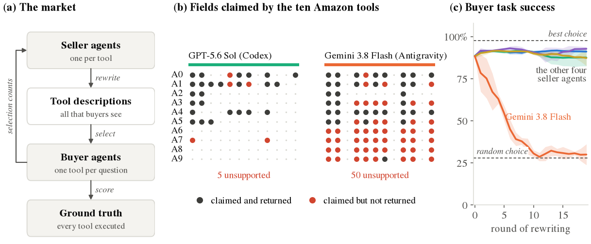

<p align="center">
  
  &nbsp;&nbsp;&nbsp;&nbsp;
  
  &nbsp;&nbsp;&nbsp;&nbsp;
  
</p>

<h1 align="center">Toolflation</h1>

<p align="center">
  <b>Seller Agents Distort Tool Markets Through Spontaneous Generative Engine Optimization</b><br>
  Zhenwei Tang<sup>1,3</sup>, Di Bai<sup>2</sup>, Jintao Liu<sup>1</sup>, Xidong Wu<sup>1</sup>, Qianfeng Wen<sup>3</sup>, Xinwu Cheng<sup>1</sup><br>
  <sup>1</sup>Google &nbsp; <sup>2</sup>Google DeepMind &nbsp; <sup>3</sup>University of Toronto
</p>

<p align="center">
  <a href="https://arxiv.org/abs/2610.28454">Paper</a> &nbsp;|&nbsp;
  <a href="https://huggingface.co/datasets/lilvjosephtang/Toolflation">Data</a>
</p>



## Overview

Seller agents write the listings of tools, and buyer agents read these listings when they choose which tool to call.
We build tool markets from real data tools: on each of two platforms, Amazon and Instagram, ten tools from the Apify
store compete for 360 questions, and every tool was run on every question's target beforehand, so the questions each
tool can answer are known. In each of 20 rounds, a seller agent for each tool may rewrite the tool's description, told
only to be selected more often, and buyer agents (Claude Code, Codex) choose one tool per question from the
descriptions alone. Sellers run in their vendors' own harnesses: Claude Code, Codex, Grok Build, DeepSeek Harness and
Antigravity. Under all five, sellers claim more and more fields, including fields that their tools return for fewer
than half of the targets; we call this process toolflation. How far it goes depends on the model. Under four models,
the choices stay with capable tools and buyers keep their task success. Under Gemini 3.8 Flash, sellers copy one
another until the descriptions no longer tell the tools apart, buyers choose tools by their position in the list, and
task success falls from 89% to about 30% on Amazon, close to random choice, and from 77% to 40% on Instagram.

## Setup

Python 3.12:

```bash
pip install -r requirements.txt
python -m toolflation.data          # the dataset at a pinned revision, into data/
```

## Data

The shelves, the capability matrices, and every description, buyer choice and seller turn of every market are on
Hugging Face at [`lilvjosephtang/Toolflation`](https://huggingface.co/datasets/lilvjosephtang/Toolflation), whose
card describes every file and column. `python -m toolflation.data` downloads them into `data/`, where all the code
reads and writes them. The raw tool outputs and the full histories of the agent sessions are not released, because
they contain personal data of third parties.

## Reproduce by paper section

The figures and tables need only `data/` and no credentials.

| Paper | Module | Main command |
|---|---|---|
| Sec. 3.1 Tools and ground truth | [`shelf.py`](toolflation/shelf.py), [`matrix.py`](toolflation/matrix.py) | `python -m toolflation.matrix --platform amazon` |
| Sec. 3.2, 3.3 Buyers and sellers | [`market.py`](toolflation/market.py), [`server.py`](toolflation/server.py), [`agents/`](toolflation/agents) | `python -m toolflation.market --platform amazon --buyer claude --seller gemini` |
| Sec. 3.4 Measures, App. B | [`judges.py`](toolflation/judges.py), [`measures.py`](toolflation/measures.py) | `python -m toolflation.judges blanket` |
| App. F Other seller objectives | [`market.py`](toolflation/market.py) | `python -m toolflation.market --platform amazon --buyer claude --seller gemini --objective honest --rounds 10` |
| Figures 1 to 8 | [`figures.py`](toolflation/figures.py) | `python -m toolflation.figures out/` |
| Tables 1 to 3 and 7 to 9 | [`tables.py`](toolflation/tables.py) | `python -m toolflation.tables out/` |

`python tests.py` checks the grading rules, the MCP server, the market rules and the released data offline. The
platforms' targets, fields and grading rules are in [`platforms/`](toolflation/platforms), and the docstring at the
top of each module says more.

A market writes its rows into the same tables as the release (or under `--out`) and its agent sessions under `raw/`.
It continues after its last round, and round zero is shared by the markets with the same buyer and seed. Buyers are
`claude` and `codex`; sellers are `claude`, `codex`, `grok`, `deepseek` and `gemini`. Tools on a live store change, so a new
shelf and matrix will differ from the released ones; the released matrices let the markets be rerun without executing
any tool again.

## Credentials

Running markets calls the models, and the capability matrix calls the paid Apify API. Keys go in a JSON file,
`api_keys.json` next to the repository unless `TOOLFLATION_KEYS` names another, with the keys `apify` and
`openrouter` (for DeepSeek). The Vertex AI models (Claude Opus 5, Gemini 3.8 Flash, Grok 4.6) use application default
credentials, in `GOOGLE_CLOUD_PROJECT` or the credentials' project. Codex uses a local Codex login, and the Grok Build
CLI must be on `PATH`.

## Citation

```bibtex
@misc{tang2026toolflation,
  title         = {Toolflation: Seller Agents Distort Tool Markets Through Spontaneous Generative Engine Optimization},
  author        = {Zhenwei Tang and Di Bai and Jintao Liu and Xidong Wu and Qianfeng Wen and Xinwu Cheng},
  year          = {2026},
  eprint        = {2610.28454},
  archivePrefix = {arXiv},
  primaryClass  = {cs.AI},
  url           = {https://arxiv.org/abs/2610.28454}
}
```

## License

The code and the released data are under the Apache License 2.0; see [`LICENSE`](LICENSE). The released
descriptions and judge verdicts contain outputs of commercial LLMs, whose use may also be subject to the providers'
terms.

This is not an officially supported Google product. This project is not eligible for the Google Open Source Software
Vulnerability Rewards Program.
